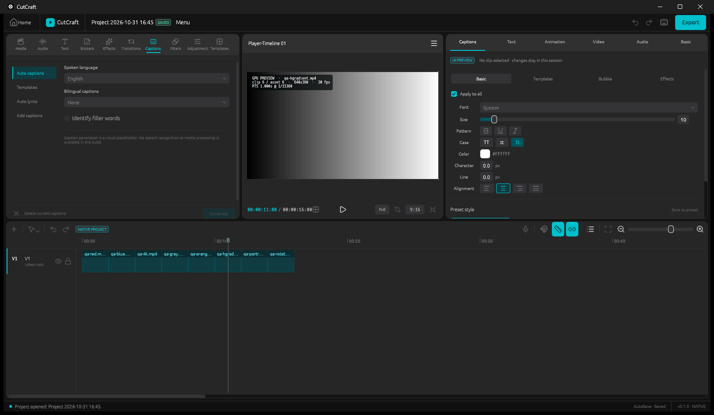

# CutCraft

### Shape your story, frame by frame.

**A modern, independent video editor built with Rust.**

CutCraft is a Windows-first desktop video editor designed around a familiar editing workspace, precise
timeline operations, and a native Rust architecture.

From managing media and editing clips to GPU-backed frame preview and automatic project recovery, CutCraft is
being built one reliable feature at a time.

**Native by design. Precise by default. Built to evolve.**



*Captured from the current build. The clips shown are synthetic H.264 test fixtures generated for this
project — see [screenshot provenance](assets/screenshots/README.md).*

---

### Edit with confidence

A timeline built on exact integer time, with validated editing commands, Split, Delete, Magnet, and
Undo/Redo.

### Preview with clarity

A renderer-owned wgpu pipeline displays decoded video frames with correct source identity, presentation
timestamps, and aspect ratio.

### Keep your work safe

Managed `.cutcraft` projects, automatic saving, and recovery snapshots help protect your editing progress.

### Built from the ground up

An independently developed Rust engine, modular architecture, and a Windows desktop interface designed for
future expansion.

---

## What is not built yet

CutCraft is in active early development. **Continuous playback, audio, video export, and full multi-layer
compositing are not yet available.** Real frame preview also depends on a locally installed FFmpeg (see
below), and hardware decoding, subtitle/effect rendering, and crash-proof durability are not implemented.

## Requirements

- **Windows** is the primary platform; everything documented here is verified on Windows.
- **Rust 1.97.1**, pinned by [`rust-toolchain.toml`](rust-toolchain.toml) with `rustfmt` and `clippy`.
- **FFmpeg (optional)** — `ffmpeg` / `ffprobe` on `PATH`, or set via `CUTCRAFT_FFMPEG` / `CUTCRAFT_FFPROBE`,
  are discovered at runtime for real H.264 frame decoding. They are **not bundled or linked**; without them
  the editor still runs and everything except decoded preview works.
- No installers or release binaries are published yet — build from source.

## Get started

```powershell
git clone https://github.com/nguyennhat2002/CutCraft.git
cd CutCraft
cargo run -p capcut-editor
```

**Checks used by CI and required before a pull request:**

```powershell
cargo fmt --all -- --check --config-path .config/rustfmt.toml
cargo clippy --workspace --all-targets -- -D warnings
cargo test --workspace
cargo check --workspace
```

## Explore

- [Roadmap](ROADMAP.md) — milestones and what has evidence rather than just code
- [Architecture](docs/ARCHITECTURE.md) — crate boundaries and the dependency order
- [Testing](docs/TESTING.md) — what is verified, and at which level
- [Contributing](CONTRIBUTING.md) — setup, gates, and repository rules
- [Design decisions](docs/ADR/) — the reasoning behind each major choice

## License

CutCraft is licensed under either of, at your option:

- **MIT license** ([LICENSE-MIT](LICENSE-MIT))
- **Apache License, Version 2.0** ([LICENSE-APACHE](LICENSE-APACHE))

SPDX expression: `MIT OR Apache-2.0`. Third-party dependencies, the fonts compiled into egui, and the Lucide
icon set keep their own terms — see [THIRD_PARTY_NOTICES.md](THIRD_PARTY_NOTICES.md).

## Disclaimer

CutCraft is an independent project and is not affiliated with, sponsored by, or endorsed by any other video
editor vendor. All third-party names and trademarks belong to their owners. This software is provided "as is",
without warranty of any kind; licensing CutCraft's code grants nothing over third-party assets, codecs,
trademarks, or your own media. Keep your own backups — automatic saving and recovery snapshots reduce the
chance of losing work but are not a durability guarantee.
